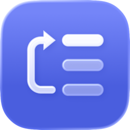
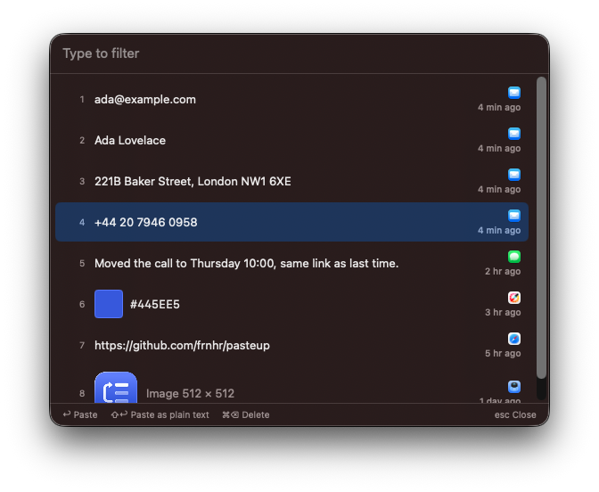
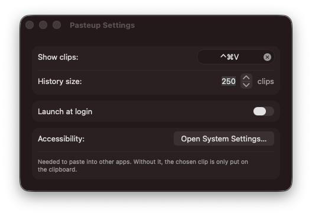

<p align="center">
  
</p>

<h1 align="center">Pasteup</h1>

<p align="center">
  A small macOS clipboard manager built for serial copy-paste:<br>
  copy several things, then paste them back one by one, in the order you copied them.
</p>

<p align="center"><b>Coded 100% by Claude.</b></p>

<p align="center">
  
</p>

## Serial paste

Say you need to move a name, an email address, a phone number and a street address from an email into a form. Copy all four, one after another. Then, in the form:

1. Press ⌃⌘V. Pasteup shows your recent clips, newest on top. Move down to the name (row 4) and press ↩. Pasteup pastes it and moves it to the top.
2. Press ⌃⌘V again. Pasteup remembers that you pasted from row 4 and highlights row 4 again, which now holds the email address. Press ↩.
3. Do the same for the phone number and the address.

After the first paste, every next clip is just ⌃⌘V, ↩. As soon as you copy something new, the picker goes back to highlighting the newest clip at the top.

The screenshot above shows this after two pastes: the name and the email address are on top, and the phone number is highlighted as the next one up.

## Features

- **Menu bar only.** No Dock icon. The picker opens in the middle of the active screen, and the paste goes to the app you were working in.
- **Keyboard first.** ↑ ↓ to move, ↩ to paste, ⇧↩ to paste as plain text, ⌘⌫ to delete a clip, type to filter, esc to clear the filter or close. Double-clicking a row also pastes.
- **Text, rich text, images, files and colors.** Every format of a copied item is kept, so the app you paste into gets the same choices it would get from the original copy. Rows show a short preview: the text, an image thumbnail, file names or a color swatch, plus the app it was copied from.
- **History that survives restarts.** Clips are stored in `~/Library/Application Support/Pasteup`. The history keeps 50 clips by default (1 to 1000 in Settings). Copying the same thing again within 2 seconds doesn't add a duplicate; otherwise duplicates are kept, because the order matters.
- **Respects password managers.** Items marked as concealed or transient (the [nspasteboard.org](http://nspasteboard.org) convention, used by 1Password and others) are not recorded.
- **Nothing leaves your Mac.** No network access, no analytics.

## Settings



You can change the hotkey, the history size and launch at login.

To paste, Pasteup puts the clip on the clipboard and presses ⌘V for you. macOS only allows that with the Accessibility permission (System Settings → Privacy & Security → Accessibility). Without it, Pasteup still moves the clip to the top and puts it on the clipboard, and you press ⌘V yourself.

## Building

There's no prebuilt release yet. Pasteup needs macOS 14 or later (it's developed on macOS 26). To build it you need Xcode 26 and [XcodeGen](https://github.com/yonaskolb/XcodeGen):

```sh
brew install xcodegen
make run    # builds a Release version, copies it to /Applications/Pasteup.app and opens it
```

Other targets: `make test` runs the tests of the core logic, `make build` makes a Debug build, and `make icons` redraws the app icon and the menu bar icon (see `Scripts/render-icons.swift`).

The build is ad-hoc signed by default. macOS ties the Accessibility permission to the app's signature, so with ad-hoc signing you have to grant it again after every rebuild. To avoid that, sign with your Apple ID (a free one works): copy `Config/Local.xcconfig.example` to `Config/Local.xcconfig` and put your team ID in it.

## Project layout

- `Packages/PasteupCore`: the history rules (the remembered row, duplicates, history size) and the picker state, as a plain Swift package with tests.
- `Pasteup`: the app: clipboard monitoring, storage, the picker panel and the settings, in SwiftUI and AppKit.
- `project.yml`: the XcodeGen spec. The Xcode project is generated from it and isn't checked in.

## Credits

Coded 100% by Claude (Anthropic), in Claude Code. Idea, direction and testing by Fran Hrženjak. The hotkey uses [KeyboardShortcuts](https://github.com/sindresorhus/KeyboardShortcuts) by Sindre Sorhus.

## License

MIT, see [LICENSE](LICENSE).
